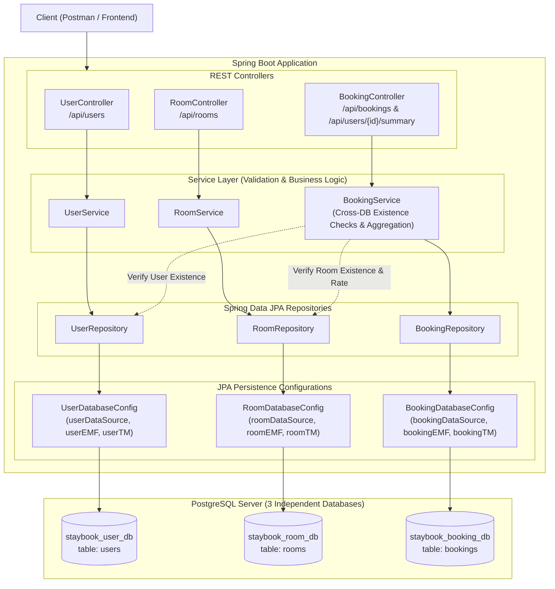

# StayBook — Multi-Database Architecture (Laboratory Work No. 8)
---

## 1. Project Overview

**StayBook** is an online hotel room reservation and management system built with Spring Boot and Spring Data JPA.  
In accordance with the requirements of **Laboratory Work No. 8**, the application is built on a **Multi-Database Architecture** connected to **three independent PostgreSQL databases**:

1. **`staybook_user_db`** (User/Guest Module) — stores guest and administrator credentials, contacts, and roles.
2. **`staybook_room_db`** (Room Module) — manages hotel room inventory, types, capacities, and night rates.
3. **`staybook_booking_db`** (Booking Module) — stores reservations, check-in/out dates, statuses, and calculated total prices.

Cross-database relationships use **logical references** (`userId`, `roomId`) rather than PostgreSQL foreign keys, because database engines cannot enforce foreign keys across distinct physical/logical databases. The **Service Layer** is responsible for validating cross-database data integrity.

---

## 2. System Architecture



---

## 3. Database Schemas

### 3.1. `staybook_user_db`
| Field | Type | Constraints | Description |
|---|---|---|---|
| `id` | BIGSERIAL | PRIMARY KEY | Unique user ID |
| `first_name` | VARCHAR(100) | NOT NULL | User first name |
| `last_name` | VARCHAR(100) | NOT NULL | User last name |
| `email` | VARCHAR(150) | NOT NULL, UNIQUE | User email address |
| `phone` | VARCHAR(50) | NULLABLE | Contact telephone |
| `role` | VARCHAR(20) | NOT NULL | `GUEST` or `ADMIN` |

### 3.2. `staybook_room_db`
| Field | Type | Constraints | Description |
|---|---|---|---|
| `id` | BIGSERIAL | PRIMARY KEY | Unique room ID |
| `room_number` | VARCHAR(50) | NOT NULL, UNIQUE | Room number/code |
| `room_type` | VARCHAR(50) | NOT NULL | `STANDARD`, `DELUXE`, `SUITE`, etc. |
| `price_per_night` | NUMERIC(10, 2) | NOT NULL | Rate per overnight stay |
| `capacity` | INT | NOT NULL | Maximum guest capacity |
| `is_active` | BOOLEAN | NOT NULL | Active/maintenance status |

### 3.3. `staybook_booking_db`
| Field | Type | Constraints | Description |
|---|---|---|---|
| `id` | BIGSERIAL | PRIMARY KEY | Unique booking ID |
| `user_id` | BIGINT | NOT NULL | **Logical reference** to `staybook_user_db.users.id` |
| `room_id` | BIGINT | NOT NULL | **Logical reference** to `staybook_room_db.rooms.id` |
| `check_in_date` | DATE | NOT NULL | Check-in date |
| `check_out_date` | DATE | NOT NULL | Check-out date |
| `total_price` | NUMERIC(10, 2) | NOT NULL | Computed total cost (`nights * price_per_night`) |
| `status` | VARCHAR(30) | NOT NULL | `CONFIRMED`, `PENDING`, `CANCELLED` |
| `created_at` | TIMESTAMP | NOT NULL | Timestamp of reservation |

---

## 4. Project Structure

```
StayBook/
├── docker-compose.yml                     # Docker Compose file to spin up PostgreSQL with 3 DBs
├── pom.xml                                # Maven build descriptors
├── sql/
│   └── init-databases.sql                 # SQL script creating 3 DBs, tables, and seed data
├── postman/
│   └── StayBook_Multi_Database_API.postman_collection.json # Ready-to-import Postman collection
└── src/
    ├── main/
    │   ├── java/org/akusher/staybook/
    │   │   ├── StayBookApplication.java   # Application entry point
    │   │   ├── config/                    # Three independent persistence configurations
    │   │   │   ├── UserDatabaseConfig.java
    │   │   │   ├── RoomDatabaseConfig.java
    │   │   │   └── BookingDatabaseConfig.java
    │   │   ├── user/                      # User module (staybook_user_db)
    │   │   │   ├── entity/User.java
    │   │   │   ├── repository/UserRepository.java
    │   │   │   ├── service/UserService.java
    │   │   │   └── controller/UserController.java
    │   │   ├── room/                      # Room module (staybook_room_db)
    │   │   │   ├── entity/Room.java
    │   │   │   ├── repository/RoomRepository.java
    │   │   │   ├── service/RoomService.java
    │   │   │   └── controller/RoomController.java
    │   │   ├── booking/                   # Booking module (staybook_booking_db) & Cross-DB Service
    │   │   │   ├── entity/Booking.java
    │   │   │   ├── repository/BookingRepository.java
    │   │   │   ├── service/BookingService.java
    │   │   │   └── controller/BookingController.java
    │   │   ├── dto/                       # Request & Response DTOs
    │   │   │   ├── UserRequestDto.java
    │   │   │   ├── UserResponseDto.java
    │   │   │   ├── RoomRequestDto.java
    │   │   │   ├── RoomResponseDto.java
    │   │   │   ├── BookingRequestDto.java
    │   │   │   ├── BookingResponseDto.java
    │   │   │   ├── BookingDetailsDto.java
    │   │   │   ├── RoomSummaryDto.java
    │   │   │   └── UserSummaryDto.java   # Final Challenge cross-database transcript DTO
    │   │   └── exception/                 # Centralized exception handling
    │   │       ├── GlobalExceptionHandler.java
    │   │       ├── ResourceNotFoundException.java   # 404
    │   │       ├── DuplicateResourceException.java  # 409
    │   │       ├── BadRequestException.java         # 400
    │   │       └── ErrorResponse.java
    │   └── resources/
    │       ├── application.properties             # Environment variable-based properties
    │       └── application.properties.example     # Sanitized example config without secrets
    └── test/
        └── java/org/akusher/staybook/             # Unit tests for services & cross-DB logic
            ├── user/UserServiceTest.java
            ├── room/RoomServiceTest.java
            └── booking/BookingServiceTest.java
```

---

## 5. Quick Start & Setup

### 5.1. Start PostgreSQL with Docker Compose
Run the following command in the root of the project to launch PostgreSQL 17 and automatically initialize all 3 databases with schemas and seed data:

```bash
docker compose up -d
```

### 5.2. Configure Environment Variables (Optional)
Defaults are configured to connect to `localhost:5433` (Docker container) with username `postgres` and password `postgres`. If using custom credentials, export them or create a `.env` file:

```bash
export DB_USERNAME=postgres
export DB_PASSWORD=your_password
```

### 5.3. Build & Run Application
```bash
./mvnw clean compile
./mvnw test
./mvnw spring-boot:run
```

The application starts on port `8089` (configured via `server.port=8089`).

---

## 6. Required REST Endpoints

### 6.1. User Endpoints (`/api/users`)
| Method | Endpoint | Description | Status Codes |
|---|---|---|---|
| `GET` | `/api/users` | List all users | `200 OK` |
| `GET` | `/api/users/{id}` | Get user by ID | `200 OK`, `404 NOT FOUND` |
| `POST` | `/api/users` | Create new user (checks unique email) | `201 CREATED`, `400 BAD REQUEST`, `409 CONFLICT` |
| `PUT` | `/api/users/{id}` | Update existing user | `200 OK`, `404 NOT FOUND`, `409 CONFLICT` |
| `DELETE` | `/api/users/{id}` | Delete user | `204 NO CONTENT`, `404 NOT FOUND` |

### 6.2. Room Endpoints (`/api/rooms`)
| Method | Endpoint | Description | Status Codes |
|---|---|---|---|
| `GET` | `/api/rooms` | List all rooms | `200 OK` |
| `GET` | `/api/rooms/{id}` | Get room by ID | `200 OK`, `404 NOT FOUND` |
| `POST` | `/api/rooms` | Create room (checks unique room number) | `201 CREATED`, `400 BAD REQUEST`, `409 CONFLICT` |
| `PUT` | `/api/rooms/{id}` | Update room details | `200 OK`, `404 NOT FOUND`, `409 CONFLICT` |
| `DELETE` | `/api/rooms/{id}` | Delete room | `204 NO CONTENT`, `404 NOT FOUND` |

### 6.3. Booking Endpoints (`/api/bookings`)
| Method | Endpoint | Description | Status Codes |
|---|---|---|---|
| `GET` | `/api/bookings` | List all bookings | `200 OK` |
| `GET` | `/api/bookings/{id}` | Get booking by ID | `200 OK`, `404 NOT FOUND` |
| `POST` | `/api/bookings` | Create booking (checks user & room exist across DBs) | `201 CREATED`, `400 BAD REQUEST`, `404 NOT FOUND` |
| `DELETE` | `/api/bookings/{id}` | Delete / cancel booking | `204 NO CONTENT`, `404 NOT FOUND` |
| `GET` | `/api/bookings/user/{userId}` | Get all bookings for specific user | `200 OK`, `404 NOT FOUND` |

### 6.4. Final Challenge: Cross-Database Aggregation (`GET /api/users/{id}/summary`)
- **Endpoint:** `GET /api/users/{id}/summary`
- **Function:** Fetches user details from `staybook_user_db`, retrieves all user reservations from `staybook_booking_db`, resolves room details for every reservation from `staybook_room_db`, and computes cumulative analytics:
  - Total number of bookings
  - Total number of confirmed stays
  - Total nights stayed across all visits
  - Total financial amount spent
  - Average cost per booking

#### Example Response:
```json
{
  "userId": 1,
  "fullName": "John Doe",
  "email": "john.doe@example.com",
  "phone": "+1-555-0101",
  "role": "GUEST",
  "totalBookings": 2,
  "confirmedBookings": 2,
  "totalNightsStayed": 6,
  "totalAmountSpent": 690.00,
  "averageBookingCost": 345.00,
  "bookings": [
    {
      "bookingId": 1,
      "checkInDate": "2026-12-01",
      "checkOutDate": "2026-12-04",
      "numberOfNights": 3,
      "totalPrice": 240.00,
      "status": "CONFIRMED",
      "createdAt": "2026-11-08T13:40:00",
      "room": {
        "roomId": 1,
        "roomNumber": "101",
        "roomType": "STANDARD",
        "pricePerNight": 80.00,
        "capacity": 2
      }
    },
    {
      "bookingId": 2,
      "checkInDate": "2026-12-15",
      "checkOutDate": "2026-12-18",
      "numberOfNights": 3,
      "totalPrice": 450.00,
      "status": "CONFIRMED",
      "createdAt": "2026-11-08T13:40:00",
      "room": {
        "roomId": 2,
        "roomNumber": "201",
        "roomType": "DELUXE",
        "pricePerNight": 150.00,
        "capacity": 3
      }
    }
  ]
}
```

---

## 7. Technical Implementation Details

### 7.1. Separate Persistence Configurations & Liquibase Migrations
Each database has its own configuration class with dedicated beans:
- `userDataSource`, `userLiquibase`, `userEntityManagerFactory` (depends on `userLiquibase`), `userTransactionManager` (marked `@Primary`)
- `roomDataSource`, `roomLiquibase`, `roomEntityManagerFactory` (depends on `roomLiquibase`), `roomTransactionManager`
- `bookingDataSource`, `bookingLiquibase`, `bookingEntityManagerFactory` (depends on `bookingLiquibase`), `bookingTransactionManager`

Liquibase migrations are isolated per database under `src/main/resources/db/changelog/`:
- `db.changelog-user.xml` manages the `users` table and initial seed users.
- `db.changelog-room.xml` manages the `rooms` table and room catalog seed data.
- `db.changelog-booking.xml` manages the `bookings` table and sample reservations.

Repositories are isolated to their respective base packages:
```java
@Configuration
@EnableTransactionManagement
@EnableJpaRepositories(
    basePackages = "org.akusher.staybook.room.repository",
    entityManagerFactoryRef = "roomEntityManagerFactory",
    transactionManagerRef = "roomTransactionManager"
)
public class RoomDatabaseConfig { ... }
```

### 7.2. Database-Specific Transactions
Database writes use the designated transaction manager:
```java
@Transactional(transactionManager = "bookingTransactionManager")
public BookingResponseDto createBooking(BookingRequestDto dto) { ... }
```

### 7.3. Centralized REST Exception Handling
`@RestControllerAdvice` maps exceptions to proper HTTP responses:
- `400 BAD_REQUEST`: Invalid booking dates (`check_out <= check_in`), room not active, `@Valid` validation constraints.
- `404 NOT_FOUND`: User, Room, or Booking not found by ID.
- `409 CONFLICT`: Duplicate email address or duplicate room number.

---

## 8. Theoretical Analysis: Transactions & Consistency in Multi-Database Systems

### 8.1. Why Local JPA Transactions Do Not Provide Atomicity Across Multiple Databases
In a single-database Spring application, `@Transactional` relies on a single `JpaTransactionManager` wrapping a single JDBC connection. It issues standard SQL commands (`BEGIN`, `COMMIT`, `ROLLBACK`) on that connection.

When an application connects to **three independent databases**:
1. **Three Separate Physical Connections:** A write that touches both `staybook_user_db` and `staybook_booking_db` involves two separate JDBC connections and two separate `PlatformTransactionManager` instances.
2. **Lack of Global Coordinator:** A standard local transaction manager only knows about its own connection. If `userTransactionManager.commit()` succeeds, but subsequently `bookingTransactionManager.commit()` fails due to a network glitch, deadlocks, or power failure, the first database cannot be automatically rolled back by the second transaction manager.
3. **Partial Failure State (Inconsistency):** This leads to the "Dual Write" problem, where one database reflects state changes while another does not, violating the **Atomicity** property of ACID transactions.

### 8.2. Solutions for Distributed Consistency
In enterprise systems, two primary patterns solve this limitation:
1. **Two-Phase Commit (2PC) / XA Transactions:**
   - Uses an XA-compliant distributed transaction coordinator (e.g., Narayana, Atomikos, Bitronix).
   - *Phase 1 (Prepare):* The coordinator asks all databases to prepare to commit and lock resources.
   - *Phase 2 (Commit):* If all acknowledge readiness, the coordinator orders a commit. If any node fails or times out, all are rolled back.
   - *Trade-offs:* High latency, blocking locks, reduced throughput, and potential single point of failure at the coordinator.
2. **Saga Pattern & Compensating Transactions (Eventual Consistency):**
   - Breaks the workflow into sequential local transactions coordinated either through events (choreography) or an orchestrator.
   - If a step fails, explicit **compensating transactions** (e.g., cancel reservation, refund payment) are executed in reverse order.
   - Preferred in modern microservices and multi-database architectures.

### 8.3. Consistency Risks When One Database is Unavailable
When retrieving cross-database aggregations (such as `GET /api/users/{id}/summary`):
- **Temporary Outage / Network Partition:** If `staybook_room_db` is unreachable while `staybook_user_db` and `staybook_booking_db` are healthy, the aggregator cannot resolve room numbers or rates.
- **Degraded Fallback vs. Fast Fail:** The service can either fail fast with a `503 Service Unavailable`, or return partial data (e.g., booking history with `room: null`) with an explanatory status flag, depending on business requirements.
- **Stale Cache / Read Inconsistencies:** If data is cached to guard against outages, changes made directly to one database can result in transient discrepancies between databases during reads.

---

## 9. Postman Collection & Testing Guide

1. Open Postman.
2. Click **Import** and select `postman/StayBook_Multi_Database_API.postman_collection.json`.
3. Set the variable `baseUrl` (default is `http://localhost:8080`).
4. Execute the requests in sequence:
   - **Users:** Create, List, Get, Update, Duplicate email test (409).
   - **Rooms:** Create, List, Get, Update, Duplicate room number test (409).
   - **Bookings:** Create booking, Verify cross-DB existence checks (404 for invalid user/room), Check date validation (400 for invalid dates).
   - **Final Challenge:** `GET /api/users/1/summary` to verify complete cross-database aggregation.
